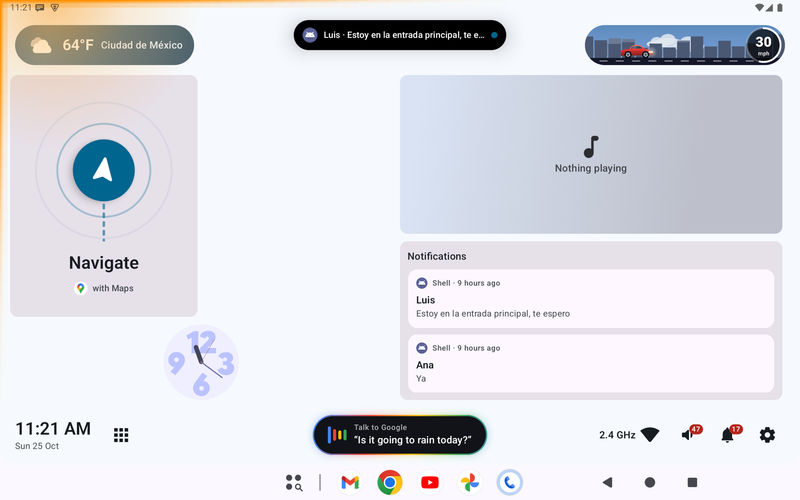
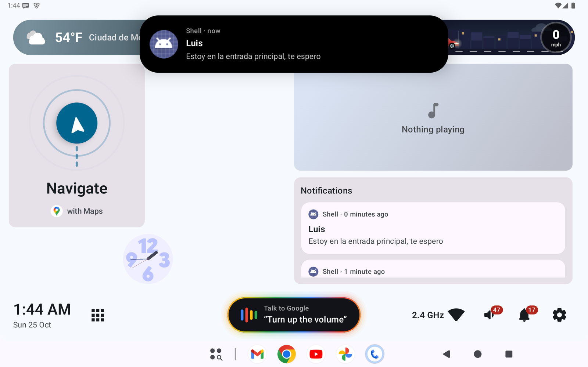
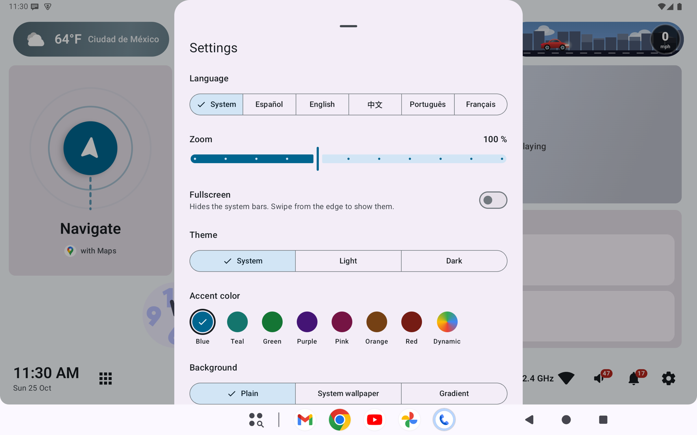

<p align="center"></p>

# Open Car Project

[English](README.md) · **Español** · [简体中文](README.zh-CN.md)

> **Abre el auto que ya tienes.** Las unidades principales de hoy tienen hardware lo
> suficientemente potente para funciones que los fabricantes bloquean o cobran como
> suscripción. Open Car Project existe para democratizar el sistema de entretenimiento del
> auto: software abierto, construido en abierto, para que cada conductor decida qué puede hacer
> su propia pantalla.
>
> Creemos que debería ser un derecho elegir cómo se ve tu auto y modernizarlo a tu gusto sin
> tener que comprar uno nuevo, porque no todos tenemos esa capacidad económica. Las horas en el
> tráfico se viven mejor en un lugar que se siente tuyo, porque tú mismo lo construiste.

Un **launcher de Android de código abierto para unidades principales de auto**. Convierte la
pantalla de la unidad principal en un tablero personalizable: navegación, música,
notificaciones, clima y una escena de velocidad viven en una cuadrícula de arrastrar y soltar,
con áreas táctiles grandes pensadas para usarse mientras se conduce.

Construido con **Kotlin + Jetpack Compose (Material 3)**, APIs nativas de Android
(`AppWidgetHost`, `MediaSession`, `NotificationListenerService`, `DataStore`) y una estructura
de Clean Architecture.


<p align="center">
  
  
  
</p>

## Funciones

| Área | Qué obtienes |
|---|---|
| **Inicio personalizable** | Mantén presionado en cualquier lugar para editar: arrastrar, redimensionar (con desplazamiento en vivo de los elementos vecinos), eliminar. Íconos de apps de media celda, widgets del sistema (p. ej., Google Calendar), tamaño de cuadrícula configurable. |
| **Módulos integrados** | **Navegación** (indicaciones del siguiente giro desde Google Maps / Waze, o un botón animado *Navegar*), **Reproductor multimedia** (portada, progreso, fondo animado vibrante), **Notificaciones** (tarjetas con vista previa, acciones, renderizado nativo para estilos no mapeados). |
| **Barra superior** | Píldora de **clima** animada (degradado según la condición) y una **escena de velocidad**: un auto / SUV / pickup / gato / perro en una ciudad que cambia según la hora del día y el clima, y que se convierte en un cohete por encima de una velocidad configurable. Velocímetro independiente opcional (circular o en línea). |
| **Isla de notificaciones** | Ventana emergente al estilo Dynamic Island para notificaciones nuevas y cambios de canción, que queda como burbuja arriba al centro con la última notificación. |
| **Brillo de movimiento** | Luz neón opcional que recorre el borde de la pantalla hacia donde va el auto, más intensa en ese punto: izquierda/derecha en las vueltas (giroscopio, o rumbo GPS), arriba al acelerar, abajo en rojo al frenar (GPS) y las esquinas entre ambos. Sensibilidad y color ajustables, con botón Probar. |
| **Dock inferior** | Reloj, cajón de apps, botón de Google Assistant con sugerencias rotativas, accesos directos a apps, hotspot, señal (4G/5G, estándar Wi-Fi), volumen, notificaciones, ajustes. |
| **Ajustes** | Tema (sistema/claro/oscuro), color de acento (incl. Material You), fondo (sólido / fondo de pantalla / degradado animado con partículas), unidades (°C/°F, km/h/mph), 12/24 h, idioma (5), zoom de la interfaz, estilo y tamaño de iconos del menú de apps, qué mostrar en las barras y más. |

> La interfaz está disponible en inglés, español, chino simplificado, portugués y francés
> (Configuración → Idioma). Nuevos idiomas son bienvenidos; consulta [CONTRIBUTING.es.md](CONTRIBUTING.es.md).

## Inicio rápido

Requisitos: **JDK 17+**, **Android SDK** con `platforms;android-37.0` y
`build-tools;37.0.0`. Gradle viene incluido con el wrapper.

```bash
git clone <this-repo> open-car-project && cd open-car-project
export ANDROID_HOME=/path/to/android-sdk      # or set sdk.dir in local.properties
./gradlew assembleDebug                        # APK: app/build/outputs/apk/debug/app-debug.apk
./gradlew installDebug                         # install on a connected device/emulator
adb shell cmd role add-role-holder android.app.role.HOME org.opencarproject.launcher
```

Después, otorga el acceso a notificaciones (lo necesitan los módulos de reproductor multimedia,
notificaciones y navegación):

```bash
adb shell cmd notification allow_listener \
  org.opencarproject.launcher/org.opencarproject.launcher.data.source.LauncherNotificationListener
```

Las instrucciones completas (configuración del emulador, herramientas de depuración,
multimedia/GPS/notificaciones simulados, pruebas) están en
**[docs/DEVELOPMENT.es.md](docs/DEVELOPMENT.es.md)**.

## Pruebas

```bash
./gradlew test                    # JVM unit tests (no device needed)
./gradlew connectedAndroidTest    # instrumented UI tests (device/emulator)
```

## Documentación

| Documento | Contenido |
|---|---|
| [docs/DEVELOPMENT.es.md](docs/DEVELOPMENT.es.md) | Compilar, ejecutar, depurar y probar (emulador, recetas de adb, herramientas solo de depuración) |
| [docs/ARCHITECTURE.md](docs/ARCHITECTURE.md) | Capas, paquetes, flujo de datos, dónde buscar cuando algo falla (en inglés) |
| [CONTRIBUTING.es.md](CONTRIBUTING.es.md) | Cómo contribuir, estilo de código, lista de verificación para PR |
| [docs/BUILD_NOTES.md](docs/BUILD_NOTES.md) | Detalles de la cadena de herramientas (nomenclatura de la plataforma Android 17 / API 37) (en inglés) |
| [docs/HOTSPOT.md](docs/HOTSPOT.md) | Mostrar los clientes del hotspot (requiere instalarlo como app del sistema) (en inglés) |
| [docs/EMBEDDING.md](docs/EMBEDDING.md) | Notas de investigación sobre incrustar ventanas de otras apps (solo apps del sistema) (en inglés) |
| [CLAUDE.md](CLAUDE.md) · [.claude/](.claude) | Convenciones, skills y agentes para asistentes de programación con IA |

## Permisos

| Permiso | Se usa para |
|---|---|
| `BIND_APPWIDGET` | Alojar widgets del sistema |
| Acceso a notificaciones (listener) | Notificaciones, sesiones multimedia, siguiente giro de la navegación |
| `ACCESS_COARSE_LOCATION` | Clima de tu zona |
| `ACCESS_FINE_LOCATION` | Velocidad real del vehículo desde el GPS (escena de velocidad / velocímetro) |
| `READ_PHONE_STATE` | Tipo de red móvil (4G/5G) en el indicador de señal |
| `INTERNET`, `ACCESS_NETWORK_STATE`, `ACCESS_WIFI_STATE` | Datos del clima, indicador de señal |

Datos del clima: [Open-Meteo.com](https://open-meteo.com/) (CC BY 4.0; gratuito para uso no comercial).

## Contribuir

Las contribuciones de cualquier tamaño son bienvenidas: reportes de errores, traducciones,
módulos nuevos, documentación. Empieza por [CONTRIBUTING.es.md](CONTRIBUTING.es.md): el
proyecto usa **gitflow** (PR hacia `develop`) y **Conventional Commits**.

## Descargas

Los APK firmados se publican en [GitHub Releases](https://github.com/maldos23/open-car-project/releases).
Los cambios se listan en [CHANGELOG.md](CHANGELOG.md) (en inglés).

## Licencia

[Apache License 2.0](LICENSE) © colaboradores de Open Car Project.
