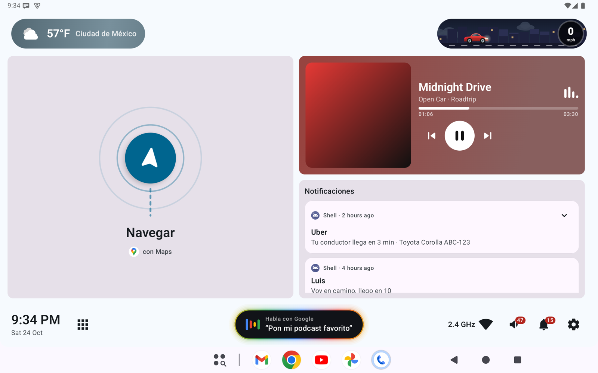

# Open Car Project

[English](README.md) · [Español](README.es.md) · **简体中文**

一款开源的**车机 Android 启动器**。它把车机屏幕变成可自定义的仪表盘：导航、音乐、通知、天气和速度场景都放在可拖放的网格上，并配有专为驾驶时使用而设计的大尺寸触控目标。

基于 **Kotlin + Jetpack Compose (Material 3)**、原生 Android API（`AppWidgetHost`、
`MediaSession`、`NotificationListenerService`、`DataStore`）以及 Clean Architecture 分层构建。



## 功能

| 方面 | 提供的功能 |
|---|---|
| **可自定义主屏幕** | 在任意位置长按即可进入编辑：拖动、调整大小（相邻项会实时让位）、删除。支持半格应用图标、系统小部件（如 Google 日历）以及可配置的网格尺寸。 |
| **内置模块** | **导航**（来自 Google 地图 / Waze 的下一转向提示，或一个动画 *Navigate* 按钮）、**媒体播放器**（封面、进度、鲜艳的动画背景）、**通知**（带预览和操作的卡片，未映射的样式使用原生渲染）。 |
| **顶部栏** | 动画**天气**胶囊（按天气状况显示不同渐变）和**速度场景**：城市中的轿车 / SUV / 皮卡 / 猫 / 狗，城市随时间和天气变化，超过可配置的速度后会变成火箭。可选的独立速度表（圆形或行内）。 |
| **通知岛** | 灵动岛风格的弹窗，用于显示新通知和曲目切换，之后以气泡形式停留在顶部中央，显示最新通知。 |
| **运动光效** | 可选的霓虹光沿屏幕边缘移动，指向车辆行驶方向，该点最亮：转弯时在左/右（陀螺仪或 GPS 航向），加速时在顶部，刹车时在底部并变红（GPS），组合时位于角落。灵敏度和颜色可调，并带有测试按钮。 |
| **底部 Dock 栏** | 时钟、应用抽屉、带轮换建议的 Google 助理按钮、应用快捷方式、热点、信号（4G/5G、Wi-Fi 标准）、音量、通知、设置。 |
| **设置** | 主题（跟随系统/浅色/深色）、强调色（含 Material You）、背景（纯色 / 壁纸 / 带粒子的动画渐变）、单位（°C/°F、km/h/mph）、12/24 小时制、语言（5 种）、界面缩放、应用菜单样式与图标大小、栏中显示的内容等。 |

> 界面支持英语、西班牙语、简体中文、葡萄牙语和法语（设置 → 语言）。欢迎贡献新语言——参见
> [CONTRIBUTING.zh-CN.md](CONTRIBUTING.zh-CN.md)。

## 快速开始

要求：**JDK 17+**，安装了 `platforms;android-37.0` 和 `build-tools;37.0.0` 的 **Android SDK**。Gradle 由 wrapper 提供。

```bash
git clone <this-repo> open-car-project && cd open-car-project
export ANDROID_HOME=/path/to/android-sdk      # or set sdk.dir in local.properties
./gradlew assembleDebug                        # APK: app/build/outputs/apk/debug/app-debug.apk
./gradlew installDebug                         # install on a connected device/emulator
adb shell cmd role add-role-holder android.app.role.HOME org.opencarproject.launcher
```

然后授予通知访问权限（媒体播放器、通知和导航模块需要）：

```bash
adb shell cmd notification allow_listener \
  org.opencarproject.launcher/org.opencarproject.launcher.data.source.LauncherNotificationListener
```

完整说明——模拟器设置、调试工具、模拟媒体/GPS/通知、测试——请见
**[docs/DEVELOPMENT.zh-CN.md](docs/DEVELOPMENT.zh-CN.md)**。

## 测试

```bash
./gradlew test                    # JVM unit tests (no device needed)
./gradlew connectedAndroidTest    # instrumented UI tests (device/emulator)
```

## 文档

| 文档 | 内容 |
|---|---|
| [docs/DEVELOPMENT.zh-CN.md](docs/DEVELOPMENT.zh-CN.md) | 构建、运行、调试和测试（模拟器、adb 用法、仅调试版工具） |
| [docs/ARCHITECTURE.md](docs/ARCHITECTURE.md) | 分层、包结构、数据流，出问题时该看哪里 |
| [CONTRIBUTING.zh-CN.md](CONTRIBUTING.zh-CN.md) | 如何贡献、代码风格、PR 检查清单 |
| [docs/BUILD_NOTES.md](docs/BUILD_NOTES.md) | 工具链细节（Android 17 / API 37 平台命名） |
| [docs/HOTSPOT.md](docs/HOTSPOT.md) | 显示热点客户端（需要作为系统应用安装） |
| [docs/EMBEDDING.md](docs/EMBEDDING.md) | 关于嵌入其他应用窗口的研究笔记（仅限系统应用） |
| [CLAUDE.md](CLAUDE.md) · [.claude/](.claude) | 面向 AI 编程助手的约定、技能和代理 |

## 权限

| 权限 | 用途 |
|---|---|
| `BIND_APPWIDGET` | 托管系统小部件 |
| 通知访问权限（监听器） | 通知、媒体会话、导航下一转向提示 |
| `ACCESS_COARSE_LOCATION` | 获取所在地区的天气 |
| `ACCESS_FINE_LOCATION` | 通过 GPS 获取真实车速（速度场景 / 速度表） |
| `READ_PHONE_STATE` | 在信号指示器中显示移动网络类型（4G/5G） |
| `INTERNET`、`ACCESS_NETWORK_STATE`、`ACCESS_WIFI_STATE` | 天气数据、信号指示器 |

天气数据：[Open-Meteo.com](https://open-meteo.com/)（CC BY 4.0；非商业用途免费）。

## 参与贡献

欢迎各种规模的贡献——错误报告、翻译、新模块、文档。请从
[CONTRIBUTING.zh-CN.md](CONTRIBUTING.zh-CN.md) 开始——本项目使用 **gitflow**（PR 提交到
`develop`）和 **Conventional Commits**。

## 下载

已签名的 APK 发布在 [GitHub Releases](https://github.com/maldos23/open-car-project/releases)。
变更记录见 [CHANGELOG.md](CHANGELOG.md)（英文）。

## 许可证

[Apache License 2.0](LICENSE) © Open Car Project 贡献者。
